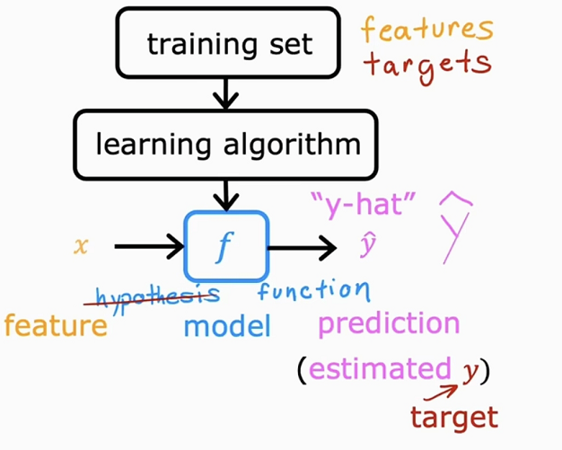
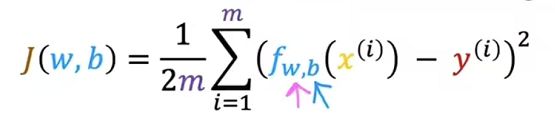
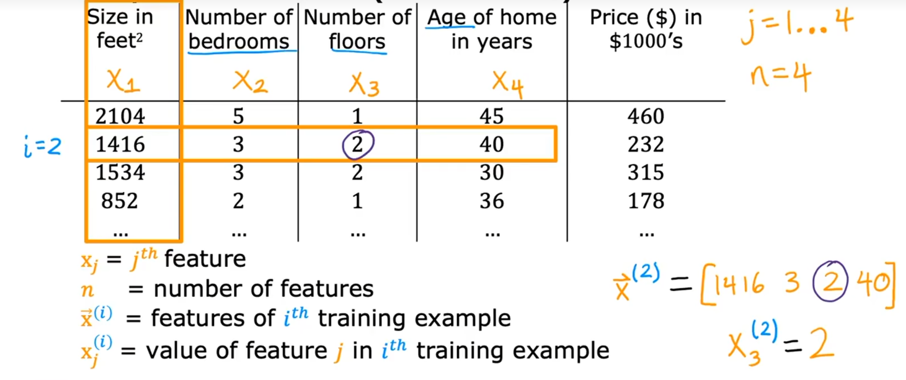
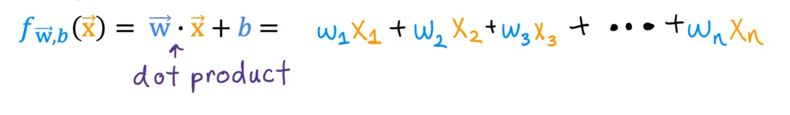
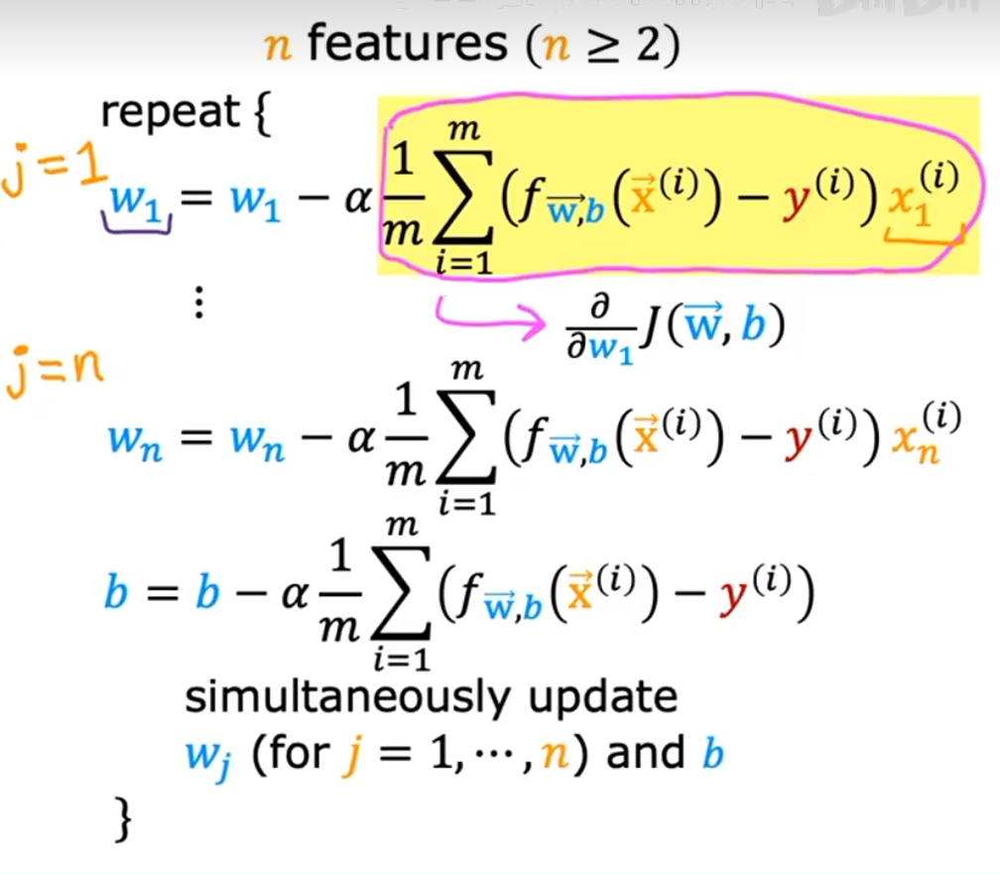
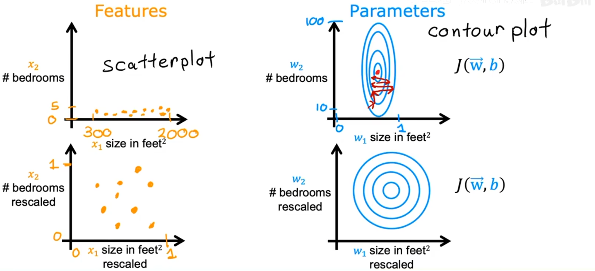
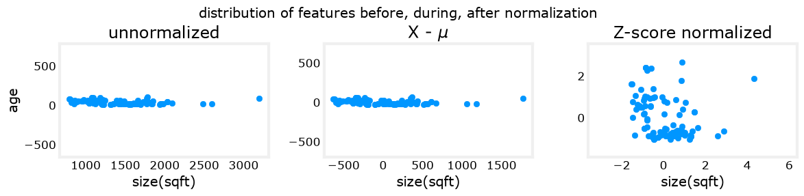

## intro

### 监督学习
从给定的正确答案中学习。

两种主要类型：
- 回归：连续
- 分类：分散

### 无监督学习
不知道正确的答案，只是尝试从中发现一些有趣的规则。

所以我们已知数据集，却不知如何处理，也未告知每个数据点是什么。别的都不知道，就是一个数据集。你能从数据中找到某种结构吗？

针对数据集，无监督学习就能判断出数据有两个不同的聚集簇。这是一个，那是另一个，二者不同。是的，无监督学习算法可能会把这些数据分成两个不同的簇。所以叫做**聚类算法**。

## 单变量线性回归

$$
f_{w,b}(x^{(i)}) = wx^{(i)} + b \tag{1}
$$

### 模型表示
训练集（Training Set）：
$m$ 训练集中样本的数量

$x$ 特征/输入变量
$y$ 目标变量/输出变量

$(x,y)$ 训练集中的实例
$(x^{(i)},y^{(i)})$ 第 $i$ 个样本

y-hat是估计值：

### 代价函数
代价函数通过 预测值y-hat 和 目标值y 的差值，即 $\hat{y} - y$，误差error

平方误差代价函数：
$$
J(w,b)=\frac{1}{2m}\sum_{i=1}^{m}\underset{\text{error}}{\left(\hat{y}^{(i)}-y^{(i)}\right)^{2}}
$$
$m$ = number of training examples

其中y-hat又可以写为：

最终，我们希望找到**使代价函数变小**的w和b的值

代价函数的直观图形见 **[cost-function](cost-function.html)**

### 梯度下降

*梯度下降* 的更新过程如下：重复执行以下步骤，直到收敛。

$$
\begin{aligned}
w &\leftarrow w - \alpha \frac{\partial J(w,b)}{\partial w} \\
b &\leftarrow b - \alpha \frac{\partial J(w,b)}{\partial b}
\end{aligned}
$$

其中，参数 $w$ 和 $b$ 必须**同时更新**。gradient 的两个分量分别为：

$$
\frac{\partial J(w,b)}{\partial w} = \frac{1}{m} \sum_{i=0}^{m-1} \left(f_{w,b}(x^{(i)}) - y^{(i)}\right)x^{(i)}
$$

$$
\frac{\partial J(w,b)}{\partial b} = \frac{1}{m} \sum_{i=0}^{m-1} \left(f_{w,b}(x^{(i)}) - y^{(i)}\right)
$$

## 多变量线性回归
术语： 

### 多元回归的梯度下降

### 特征缩放
当你有不同特征*取值范围差异很大*时，可能会导致梯度下降得很慢。
通过重新缩放不同的特征，可以显著加快下降的速度

#### Z-score 标准化
经过 z-score 标准化 后，每个 **feature 的 mean（均值）为 0，standard deviation（标准差）为 1**。

按照下面的公式调整输入值，即可实现 z-score 标准化

$$
x_j^{(i)} := \frac{x_j^{(i)}-\mu_j}{\sigma_j}
$$

其中，$\mu_j$ 是第 $j$ 个 feature 所有值的 mean，$\sigma_j$ 是该 feature 的 standard deviation。

$$
\mu_j=\frac{1}{m}\sum_{i=0}^{m-1}x_j^{(i)}
$$

$$
\sigma_j^2=\frac{1}{m}\sum_{i=0}^{m-1}\left(x_j^{(i)}-\mu_j\right)^2
$$

例如：
下图展示了训练集中两个 feature——房龄 `age` 和面积 `size(sqft)`——之间的关系。*图中的两个坐标轴使用相同的比例尺。*

- 左图：未经 normalization。`size(sqft)` 的取值范围和 variance（方差）远大于 `age`。
- 中图：第一步，从每个 feature 中减去对应的 mean，使其以 0 为中心。`age` 的变化不太明显，而 `size(sqft)` 明显移到了 0 附近。
- 右图：第二步，除以对应的 standard deviation。两个 feature 都以 0 为中心，并具有相近的尺度。
