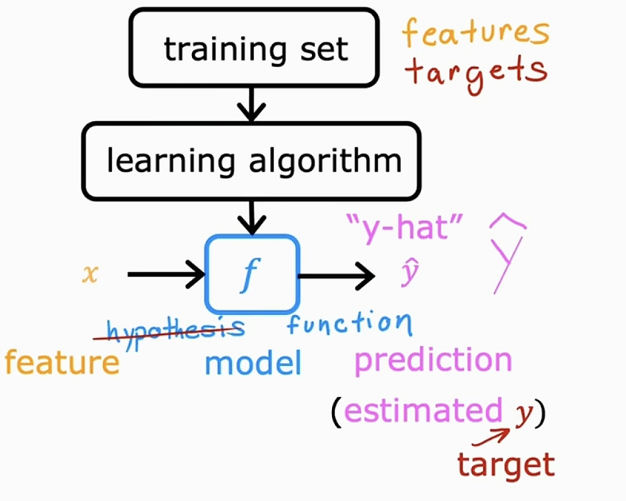
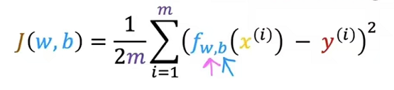

## intro

### 监督学习
从给定的正确答案中学习。

两种主要类型：
- 回归：连续
- 分类：分散

### 无监督学习
不知道正确的答案，只是尝试从中发现一些有趣的规则。

所以我们已知数据集，却不知如何处理，也未告知每个数据点是什么。别的都不知道，就是一个数据集。你能从数据中找到某种结构吗？

针对数据集，无监督学习就能判断出数据有两个不同的聚集簇。这是一个，那是另一个，二者不同。是的，无监督学习算法可能会把这些数据分成两个不同的簇。所以叫做**聚类算法**。

## 单变量线性回归

### 模型表示
训练集（Training Set）：
$m$ 训练集中样本的数量

$x$ 特征/输入变量
$y$ 目标变量/输出变量

$(x,y)$ 训练集中的实例
$(x^{(i)},y^{(i)})$ 第 $i$ 个样本

y-hat是估计值：

## 代价函数
代价函数通过 预测值y-hat 和 目标值y 的差值，即 $\hat{y} - y$，误差error

平方误差代价函数：
$$
J(w,b)=\frac{1}{2m}\sum_{i=1}^{m}\underset{\text{error}}{\left(\hat{y}^{(i)}-y^{(i)}\right)^{2}}
$$
$m$ = number of training examples

其中y-hat又可以写为：

最终，我们希望找到**使代价函数变小**的w和b的值