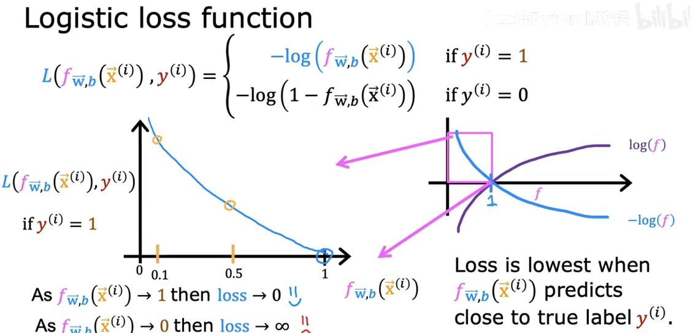

# 逻辑回归
- 由于逻辑回归 target $y$ 只能为 0 或 1，我们希望模型输出位于 0 与 1 之间。
- Sigmoid function 可以把任意实数输入映射到 0 与 1 之间，从而实现这一点。

## 代价函数

### 损失函数
当 y=1 时，损失函数中，预测值 $f_{\vec{w},b}\left(\vec{x}^{(i)}\right)$ 越趋近于1，表明预测的越准确，损失就越小。 趋近于 0，则表示和实际值 1 差距越大，预测越不准确
