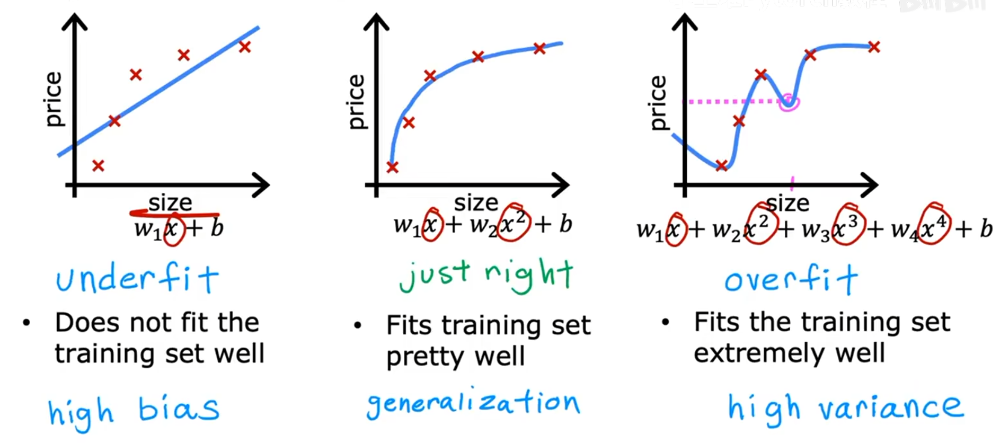
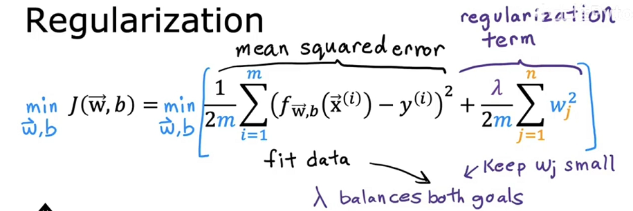

# 逻辑回归
- 由于逻辑回归 target $y$ 只能为 0 或 1，我们希望模型输出位于 0 与 1 之间。
- Sigmoid function 可以把任意实数输入映射到 0 与 1 之间，从而实现这一点。

## 代价函数

### 损失函数
**loss** 衡量单个样本的预测与 target 之间的差异，用 **cost** 汇总整个训练集上的 loss。

当 y=1 时，损失函数中，预测值 $f_{\vec{w},b}\left(\vec{x}^{(i)}\right)$ 越趋近于1，表明预测的越准确，损失就越小。 趋近于 0，则表示和实际值 1 差距越大，预测越不准确

上面的分段定义可以改写为更方便实现的形式： 
$$
\operatorname{loss}(f_{\vec{\mathbf{w}},b}(\mathbf{x}^{(i)}),y^{(i)})
=-y^{(i)}\log\left(f_{\vec{\mathbf{w}},b}(\mathbf{x}^{(i)})\right)
-(1-y^{(i)})\log\left(1-f_{\vec{\mathbf{w}},b}(\mathbf{x}^{(i)})\right)
$$

# 正则化(Regularization)

## 过拟合

- 欠拟合： 训练数据上都无法很好地拟合
- 泛化： 在训练集之外的例子上也能表现良好
- 过拟合：训练集上表现很好，但是在从未见过的新样本上无法泛化(*过度迎合训练数据,把训练集中的噪声、偶然特点也当成了普遍规律*)

## 解决过拟合
1. 收集更多数据
2. 正则化：让你保留所有的特征（而不是直接丢弃一些特征），但是减少参数的大小

## 带正则化的代价函数

- MSE均方误差 希望预测误差小
- 正则项 希望权重也别太大

减小参数并不一定能减少过拟合。正则化的作用，是限制模型为了迎合训练数据中的噪声而做出*过大的调整*。所以，正则化是在拟合训练数据和限制权重之间做取舍

## 正则化梯度下降

Linear regression 和 logistic regression 的 gradient 形式几乎相同，区别仅在于 $f_{\mathbf{w},b}$ 的计算：

$$
\frac{\partial J(\mathbf{w},b)}{\partial w_j}
=\frac{1}{m}\sum_{i=0}^{m-1}\left(f_{\mathbf{w},b}(\mathbf{x}^{(i)})-y^{(i)}\right)x_j^{(i)}+\frac{\lambda}{m}w_j
$$

$$
\frac{\partial J(\mathbf{w},b)}{\partial b}
=\frac{1}{m}\sum_{i=0}^{m-1}\left(f_{\mathbf{w},b}(\mathbf{x}^{(i)})-y^{(i)}\right)
$$

- $m$ 是训练样本数，$f_{\mathbf{w},b}(\mathbf{x}^{(i)})$ 是预测值，$y^{(i)}$ 是 target。
- 对于 **linear regression**：$f_{\mathbf{w},b}(\mathbf{x})=\mathbf{w}\cdot\mathbf{x}+b$。
- 对于 **logistic regression**：$z=\mathbf{w}\cdot\mathbf{x}+b$，$f_{\mathbf{w},b}(\mathbf{x})=g(z)$，其中 sigmoid function 为 $g(z)=\frac{1}{1+e^{-z}}$。

Regularization 在 $w_j$ 的 gradient 中增加了 $\frac{\lambda}{m}w_j$。