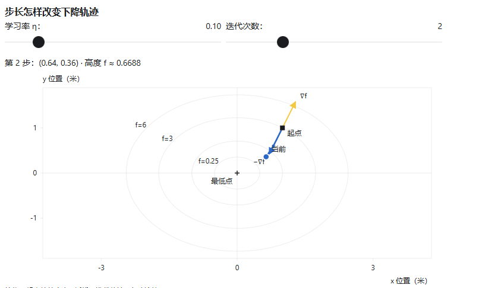

## 导数和偏导数
偏导数，就是固定其他变量，只研究其中一个变量的变化率。

## 梯度和梯度下降
假设我们站在山坡
\[
f(x,y)=x^2+2y^2
\]

\[
f_x=2x,  f_y=4y
\]
上的 (1,1) 处，此时两个偏导数是 2 和 4。

**1. 斜着移动，高度怎么变？**
假设你向 \(x\) 方向移动 \(\Delta x\)，同时向 \(y\) 方向移动 \(\Delta y\)。高度变化近似为：
\[
\boxed{\Delta z\approx 2\Delta x+4\Delta y}
\]
也就是：

\[
\text{高度变化}
\approx
\underbrace{2\times x\text{方向的移动量}}_{x\text{方向的贡献}}
+
\underbrace{4\times y\text{方向的移动量}}_{y\text{方向的贡献}}
\]

**2. 要比较哪个方向“最快”，必须规定走同样远。**
设你移动的总距离是很小的 \(\varepsilon\)，用长度为 \(1\) 的向量 \(\mathbf u=(u_x,u_y)\) 表示方向：
\[
\Delta x=\varepsilon u_x,\qquad
\Delta y=\varepsilon u_y,\qquad
u_x^2+u_y^2=1
\]
那么：
\[
\Delta z\approx\varepsilon(2u_x+4u_y)
\]

在方向向量长度固定为 1 时，怎样让 \(2u_x+4u_y\) 最大？
这个式子，恰好是两个向量的点积。
\[
2u_x+4u_y=(2,4)\cdot\mathbf u
\]
假设 \(\theta\) 是移动方向与梯度之间的夹角。
- 同向时，\(\cos\theta=1\)，上升率最大。
- 反向时，\(\cos\theta=-1\)，下降率最大。
- 垂直时，\(\cos\theta=0\)，一阶变化率为零。

所以，斜着走可以比只沿 \(y\) 方向走上升得更快。

**3. 学习率**

梯度下降，就是反复计算当前位置的梯度，再沿反方向走一步。

用 \(\mathbf p_k=(x_k,y_k)\) 表示第 \(k\) 次的位置：
\[
\boxed{\mathbf p_{k+1}=\mathbf p_k-\eta\nabla f(\mathbf p_k)}
\]

其中 \(\eta>0\) 叫作学习率。

展开成两个坐标：
\[
\begin{aligned}
x_{k+1}&=x_k-\eta f_x(x_k,y_k),\\
y_{k+1}&=y_k-\eta f_y(x_k,y_k).
\end{aligned}
\]
两个偏导数都在更新前的同一个位置计算，然后一起更新坐标。

从 \((1,1)\) 出发，取 \(\eta=0.1\)。第一步：
\[
(1,1)-0.1(2,4)=(0.8,0.6)
\]

高度变成：
\[
f(0.8,0.6)=0.8^2+2(0.6)^2=1.36
\]

走到新位置后，要重新计算梯度：
\[
\nabla f(0.8,0.6)=(1.6,2.4)
\]
第二步：
\[
(0.8,0.6)-0.1(1.6,2.4)=(0.64,0.36)
\]
高度继续降低：
\[
3\ \longrightarrow\ 1.36\ \longrightarrow\ 0.6688
\]
这就是“计算方向—移动—重新计算方向”的迭代过程。

## 链式法则
假设你正在上一讲的山坡上行走：
\[
z=f(x,y)=x^2+2y^2
\]
你的路线由时间 \(t\) 决定：
\[
x(t)=1+t,\qquad y(t)=1-t
\]
也就是说，你一直向正 \(x\) 方向走，同时向负 \(y\) 方向走。现在想知道：**你的海拔每秒变化多少？**

时间先改变位置，位置再改变高度：
\[
t\ \longrightarrow\ (x,y)\ \longrightarrow\ z
\]
链式法则研究的，就是变化率怎样沿着这样的依赖关系传递。

先算出发这一刻，两个方向各贡献多少。

当 \(t=0\) 时，你在 \((1,1)\)。这里的两个偏导数是：
\[
f_x=2x=2,\qquad f_y=4y=4
\]
而你的坐标变化速度是：
\[
\frac{dx}{dt}=1,\qquad \frac{dy}{dt}=-1
\]
因此：
- \(x\) 的变化带来：\(2\times1=+2\) 米/秒的高度变化。
- \(y\) 的变化带来：\(4\times(-1)=-4\) 米/秒的高度变化。
合起来：
\[
\frac{dz}{dt}=2-4=-2\ \text{米/秒}
\]
**对于可微函数 \(z=f(x,y)\)，如果 \(x,y\) 都随 \(t\) 变化，那么：**

\[
\boxed{
\frac{dz}{dt}
=
\frac{\partial f}{\partial x}\frac{dx}{dt}
+
\frac{\partial f}{\partial y}\frac{dy}{dt}
}
\]

另一种方式：
**局部近似：**
\[
\Delta z\approx f_x\Delta x+f_y\Delta y
\]
两边除以时间间隔 \(\Delta t\)：
\[
\frac{\Delta z}{\Delta t}
\approx
f_x\frac{\Delta x}{\Delta t}
+
f_y\frac{\Delta y}{\Delta t}
\]
再让 \(\Delta t\to0\)，就得到链式法则。