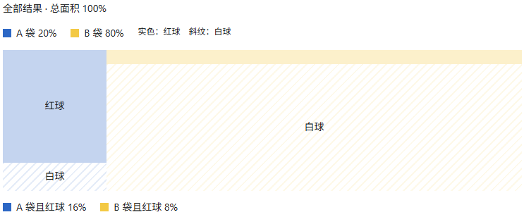

## 概率基础
假设有两个袋子：
- A 袋：8 个红球、2 个白球。
- B 袋：1 个红球、9 个白球。
每次先选袋子：以 20% 的概率选 A，以 80% 的概率选 B；然后在选中的袋子里等可能地抽一个球。
现在，你看见抽出来的是红球，但不知道选了哪个袋子。它来自 A 袋的概率是多少？

符号 \(P(R\mid A)\) 读作“已知选中 A 袋时，抽到红球的概率”：
\[
P(R\mid A)=\frac{8}{10}=0.8.
\]
理解条件概率，关键在于：**已知一个条件后，我们把比较*范围缩小*到满足这个条件的结果。**

用 \(A\cap R\) 表示“A 和 R 同时发生”，条件概率的定义就是：
\[
\boxed{
P(A\mid R)=\frac{P(A\cap R)}{P(R)}
}
\qquad P(R)>0.
\]

选中 A 的概率是 \(0.2\)，选中之后抽到红球的概率是 \(0.8\)，第二项已经是“选中 A 之后”的条件概率。只有独立时，才能把 \(P(R\mid A)\) 换成 \(P(R)\)，所以：
\[
P(A\cap R)
=P(A)\,P(R\mid A)
=0.2\times0.8
=0.16.
\]

把刚才计算分子的乘法公式代入条件概率定义，就得到**贝叶斯定理**：
\[
\boxed{
P(A\mid R)
=\frac{P(R\mid A)\,P(A)}{P(R)}
}
\qquad P(R)>0.
\]

- 先验概率 \(P(A)\)：看到球之前，选中 A 的概率，原本是 20%。
- 似然 \(P(R\mid A)\)：假定选中了 A，出现红球这个证据的概率，是 80%。
- 后验概率 \(P(A\mid R)\)：看到红球之后，选中 A 的概率，更新为约 66.7%。

## 最大似然估计

