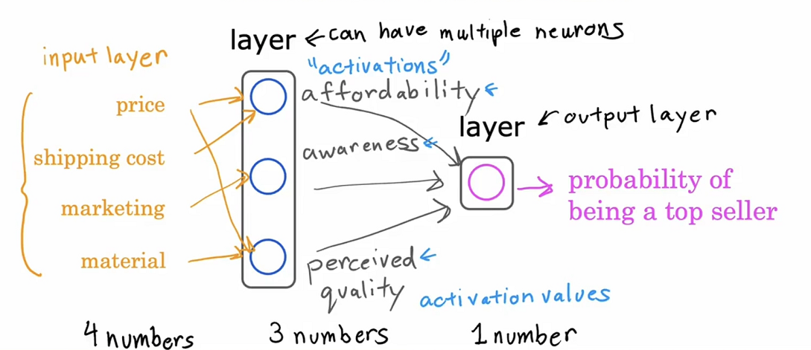
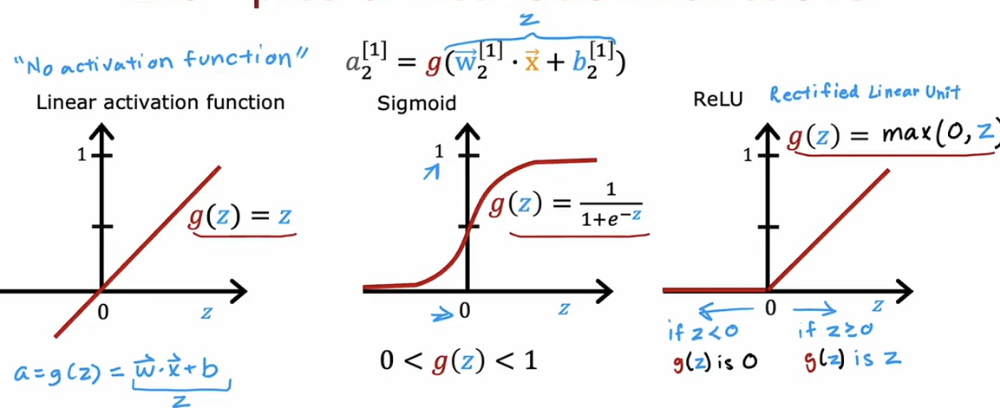
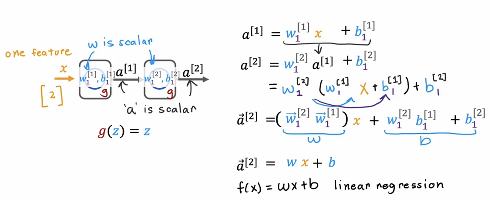
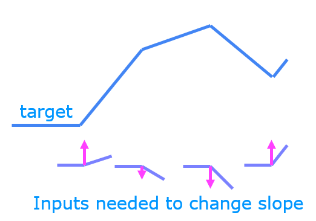
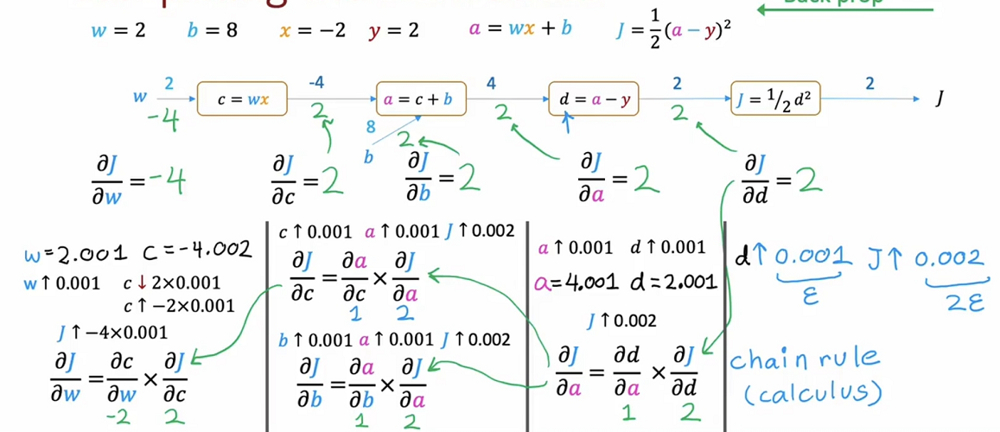
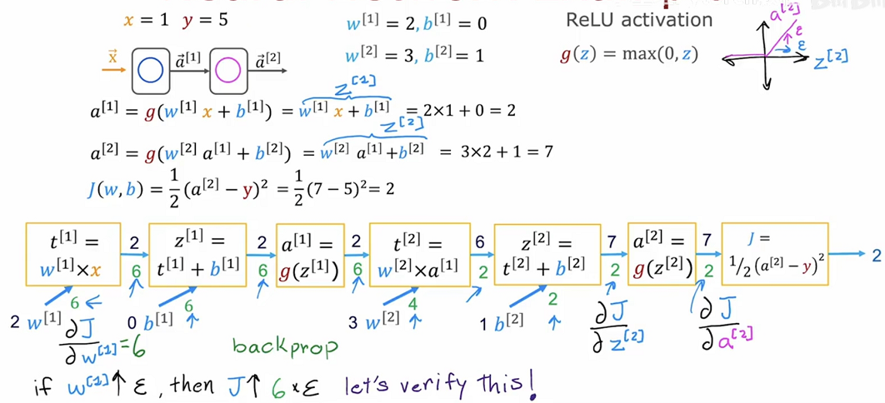

# 模型表示

# 激活函数
## 3种常见的激活函数

**如果隐藏层全部使用线性激活，加深网络也只能表达出线性能力，不会超过线性回归**

而 ReLU 的非线性行为可以让一个函数分量在需要时才产生贡献：

# Multiclass Classification
## softmax
$$
\text{softmax}(z)_i = \frac{e^{z_i}}{\sum_{j=1}^{n} e^{z_j}}, \quad i = 1,\dots,n
$$

# 反向传播
## 计算图
利用链式法则逐渐求导：

